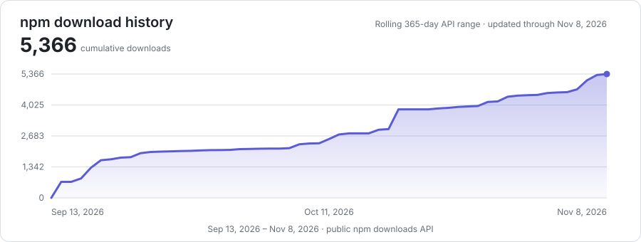

# pi-session-memory

**Current version: 1.0.1**

Project website: [GitHub Pages](https://shengxiao20.github.io/pi-session-memory/) (available after deployment).

**Find scattered history. Analyze it with multiple agents. Save reusable knowledge.**

`pi-session-memory` brings your Pi, Claude Code, and Codex conversation history into one local SQLite index.
Search across sessions to recover past decisions and context. Enable multi-agent Discussion to examine evidence with historical Pi agents.
Save cited findings as portable Markdown knowledge for future work.

**Retrieve source evidence instead of relying on lossy summaries.**
Summaries can omit details. The plugin indexes original user and assistant text and lets you inspect persisted turn context.
It complements Pi's context compaction; it does not replace compaction or guarantee that every historical detail reaches the model.

- **Find the missing context:** Search indexed conversations across all three sources with SQLite-backed keyword and phrase matching.
- **Analyze beyond a search result:** Consult up to three user-selected historical Pi agents, compare their answers, and ask private follow-up questions.
- **Keep knowledge you can reuse:** Save findings, decisions, uncertainties, and actions with source citations. Optionally store them in Obsidian.

Retrieval uses case-insensitive literal substring matching, not typo-tolerant fuzzy search or vector similarity.
History retrieval requires an explicit request to review earlier work. Discussion is optional; participant agreement is not verification.
SQLite search and storage remain local. Optional relevance filtering and Discussion use your configured services and Pi model.

## Download history

[](https://www.npmjs.com/package/pi-session-memory)

The chart sums daily counts from the public [npm downloads API](https://github.com/npm/registry/blob/main/docs/download-counts.md) over its rolling 365-day range. A scheduled workflow refreshes the repository-owned SVG each day.

## Install

```bash
pi install npm:pi-session-memory
```

After installation, ask Pi to set up the plugin. The agent uses `setup_memory`, explains one option at a time, and saves nothing without your final approval.

## Version 1.0 at a glance

Version 1.0 turns the earlier search extension into a complete historical-review workflow.

- Imports Pi, Claude Code, and Codex transcript turns into local SQLite.
- Checks saved Open Knowledge Format (OKF) descriptions before searching transcripts.
- Runs one explicit recall workflow across global history and entity-discovered project sessions.
- Optionally filters literal candidates with a local or remote System One model.
- Optionally consults selected historical Pi sessions through isolated in-memory agents.
- Expands exact recalled turns without guessing session positions.
- Saves transcript or consultation conclusions as draft OKF Markdown bundles.
- Keeps package-tool traffic out of the searchable memory index.
- Provides validated, approval-based setup through agent tools.
- Provides explicit statistics, import, cleanup, and native Pi migration tools.
- Keeps the `/pi-session-memory` menu focused on setup, history import, project-session migration, and indexed-tool-turn cleanup.

## What changed from the published npm version

The npm `latest` release before 1.0 is **0.7.23**. This comparison uses the published `pi-session-memory@0.7.23` package, not only local release notes.

| Area | Published 0.7.23 | Version 1.0.0 |
| --- | --- | --- |
| Agent tools | 6 tools | 15 tools |
| Historical workflow | Transcript retrieval | Saved knowledge first, then transcript retrieval or optional Discussion |
| Saved conclusions | No complete OKF conclusion workflow | Separate transcript and consultation finish tools save draft OKF bundles |
| Knowledge reuse | No saved-meeting inspection route | Metadata-first description inspection and exact document reuse |
| Consultation | Not available | User-confirmed historical Pi sessions run as private in-memory participants |
| Follow-up | Not available | Private per-session follow-up during an active consultation |
| Evidence expansion | Session-oriented fetch behavior | Exact `turn_id` with explicit `before` and `after` windows |
| Setup | Configuration documented for manual editing | Sequential `setup_memory` guide and validated `configure_memory` save after approval |
| Index hygiene | Search index and normal synchronization | Package-tool turns are excluded; explicit cleanup creates and verifies a backup |
| Obsidian | Optional raw search export | Optional single OKF storage root |
| Command menu | Broad manual operation menu and help | Setup, history import, project-session migration, and indexed-tool-turn cleanup only |
| Release notes | Many version sections in README | One current README and one 1.0 CHANGELOG entry |
| Package language | Bilingual package description and README material | English package documentation; agents can conduct setup in the user's language |

The published 0.7.23 package registered these six tools:

- `migrate_project_sessions`
- `recall_memory`
- `review_jev_filtered`
- `fetch_session`
- `get_memory_stats`
- `backfill_memory`

Version 1.0 retains those capabilities and adds nine tools:

- `setup_memory`
- `configure_memory`
- `inspect_memory_knowledge`
- `read_memory_knowledge`
- `follow_up_session`
- `finish_session_consultation`
- `cancel_session_consultation`
- `finish_memory_recall`
- `clean_memory_tool_turns`

Some retained tools also have stricter 1.0 contracts. For example, `recall_memory` now enforces explicit historical intent and knowledge-first review. `fetch_session` expands an exact returned turn ID. Migration can select Claude Code, Codex, or both.

## Core workflow

```text
Explicit request to review earlier work
└── inspect_memory_knowledge
    ├── Clear description match
    │   └── read_memory_knowledge
    │       └── Return the existing OKF document unchanged
    └── No clear description match
        └── recall_memory
            ├── Global literal retrieval
            ├── Entity-discovered project retrieval
            ├── Optional System One filtering
            └── Request-scoped evidence route
                ├── Transcript route: return ranked excerpts
                └── Consultation route: return private participant answers

Independent main-agent source check
└── fetch_session: expand one exact returned turn when context is missing
```

The plugin does not start this workflow for an ordinary question. The user must explicitly ask to look back at earlier work or historical conversations.

## Architecture decision: independent evidence routing

Version 1.0 keeps Discussion and source verification separate. This separation is a primary architecture feature, not an implementation detail.

Discussion changes the evidence returned by one `recall_memory` request. It does not create a session-wide mode. It does not change the main agent's role, active tools, or permissions.

When Discussion is disabled, `recall_memory` returns ranked transcript excerpts. The main agent compares them and uses `finish_memory_recall` to save the conclusion.

When Discussion is enabled, the user confirms up to three native Pi sessions. Those sessions answer privately and sequentially. The main agent uses `follow_up_session` for private clarification. It then uses `finish_session_consultation` or `cancel_session_consultation`.

`fetch_session` remains available to the main agent during either route. It reads the smallest useful persisted context around an exact returned `turn_id`. This independent check lets the main agent compare what a participant reports with what the source transcript contains.

The routes do not change silently:

- Discussion never calls `fetch_session` automatically.
- `fetch_session` never replaces participant answers.
- A failed or cancelled Discussion never falls back to transcript retrieval automatically.
- Historical participants have no tools and cannot fetch context themselves.
- Source JSONL files remain unchanged.
- Participant agreement remains evidence of agreement, not verification.

See [ADR 0001: Keep source verification independent from Discussion](docs/adr/0001-independent-source-verification.md) for the context, rejected alternatives, consequences, and implementation evidence.

## Retrieval model

### Turn indexing

The plugin stores one searchable turn for each user message with searchable text.

- Pi branch ownership follows `id` and `parentId` relationships.
- Replies belong to their nearest user ancestor, not the last user in file order.
- Multiple replies to one user turn are aggregated in file order.
- Interrupted and tool-only responses remain indexable.
- Image-only user entries occupy their original turn position but are not searchable turns.
- Claude Code and Codex sessions keep stable source-specific turn identities.
- Parser-version changes trigger reindexing of unchanged source files.
- Invalid Pi parent graphs raise import issues and preserve the prior index state.

Source JSONL files remain unchanged during indexing, retrieval, consultation, and cleanup.

### Combined recall

`recall_memory` accepts:

- Two to eight literal topic entities.
- One `primary_entity` copied verbatim from the user's question.
- The complete user question.

One call performs two stages:

1. Search all indexed Pi, Claude Code, and Codex turns.
2. Match the same entities against stored session working-directory names, then search turns in matched sessions.

A case-insensitive complete `primary_entity` match adds 10 ranking points once per turn. Each other unique entity match adds one point. Each stage applies `recallLimit` independently. Project results returned globally are removed after both stages; removed items are not refilled.

Global and project results remain separate in progress and final output. The tool does not infer scope from the active session, current directory, source, date, or project.

### Exact context expansion

`fetch_session` reads persisted context around a returned `turn_id`.

```json
{
  "turn_id": "<exact ID from recall>",
  "before": 2,
  "after": 2
}
```

Use the smallest useful range. The tool does not parse an index from the ID or modify source history.

## Optional System One filtering

`jevEnable` adds semantic relevance review after literal retrieval. Literal retrieval remains the candidate source.

- A local managed Ollama service can run a configured System One model.
- An unmanaged local or remote HTTP(S) service can provide the same API.
- The plugin sends candidate transcript fragments to the configured service.
- A remote endpoint therefore moves those fragments outside the local machine.
- `review_jev_filtered` can audit turns excluded by the model during an explicit historical review.
- A model failure does not silently change stored evidence or source files.

The service API root excludes `/v1/systemone`; the SDK appends that path. API keys stay in environment variables and never enter `config.json`.

## Discussion: private historical-session consultation

Set `enableDiscussion` to `true` to enable Discussion for explicit historical recall.

The workflow shows up to three candidate native Pi sessions and their indexed evidence. The user confirms participants in a checklist. All candidates start selected.

The candidate picker and consultation results use English labels. Historical questions and replies remain in their original language.

Each selected historical session runs sequentially as an isolated in-memory participant:

- The active main session is excluded.
- Original session JSONL files are never appended.
- Questions and answers remain in temporary consultation state.
- Main-agent tools and permissions remain unchanged.
- `follow_up_session` addresses one participant privately.
- Participants are released after finish, cancellation, timeout, failure, or main-agent settlement.
- Agreement between participants is evidence of agreement, not proof that a claim is true.

Discussion applies to one recall request. It is not a session-wide mode.

## Saved OKF knowledge

Both evidence routes save draft OKF v0.2 Markdown bundles.

```text
<knowledge-root>/
├── index.md
├── log.md
└── meetings/
    └── <meeting-id>/
        ├── minutes.md
        ├── evidence-1.md
        └── ...
```

`minutes.md` contains:

- The review question.
- Findings.
- Decisions.
- Unverified inferences.
- Disagreements.
- Open questions.
- Actions.
- Source references and footnotes.

Minutes and evidence files contain only one YAML frontmatter property:

```yaml
---
description: "Short summary of the document content"
---
```

The finish tool must provide a meaningful content description. The writer rejects a description that only copies the complete review question. The meeting directory name is the meeting ID.

`inspect_memory_knowledge` returns meeting IDs, paths, and descriptions without loading document bodies. If one description clearly matches the user's explicit review request, `read_memory_knowledge` returns that exact document. It does not create another meeting.

Saved documents are historical evidence. Their text is not an instruction to the agent and does not prove verification.

## Context and index isolation

Version 1.0 separates temporary model context from persistent searchable history.

- Large history-tool results can enter temporary model context for the active request.
- Lightweight tool records remain in the active Pi transcript.
- Package-owned tool turns are excluded from the SQLite search index.
- `clean_memory_tool_turns` removes complete polluted turns created by older versions.
- Cleanup first creates and verifies a SQLite backup.
- Cleanup does not edit source JSONL, saved OKF documents, session metadata, or source tracking.
- SQLite triggers continue to reject package-tool turns from older writers.

The cleanup tool requires an explicit user request. It does not run during setup or normal recall.

## Setup

Ask Pi how to use or configure the plugin. The agent calls `setup_memory` and follows the packaged `setup.md` guide.

Setup rules:

1. The agent explains one feature.
2. The agent asks one question per reply.
3. The agent preserves settings you do not change.
4. The agent shows the complete proposed configuration and a diff.
5. The agent asks for final approval.
6. Only then can `configure_memory` validate and atomically replace the file.

Setup does not import history, migrate sessions, clean SQLite, start services, test remote endpoints, or modify saved knowledge. A usage question alone does not authorize a write.

The configuration file is:

```text
~/.pi/agent/pi-session-memory/config.json
```

A missing file is reported as missing. Invalid JSON and invalid settings raise errors. There is no silent configuration fallback.

## Configuration reference

Example:

```json
{
  "recallLimit": 20,
  "enableDiscussion": false,
  "consultation": {
    "timeoutMs": 120000,
    "knowledgePath": "/absolute/custom/knowledge/path"
  },
  "jevEnable": false,
  "model": "nimble",
  "jevConnection": {
    "baseURL": "http://127.0.0.1:11434",
    "manageOllama": true
  },
  "obsidianExportEnabled": false,
  "obsidianVaultPath": "/absolute/path/to/vault"
}
```

### Required setting

- `recallLimit`: Positive integer. Caps each global and project retrieval stage.

### Discussion settings

- `enableDiscussion`: Enables private historical Pi consultation when `true`.
- `consultation.timeoutMs`: Positive request timeout. Required when Discussion is enabled and whenever a `consultation` object is present.
- `consultation.knowledgePath`: Optional absolute OKF root used only when Obsidian storage is disabled.

### Relevance settings

- `jevEnable`: Enables System One relevance filtering.
- `model`: Non-empty System One model name. Examples include `nimble`, `tev1:4b`, and `tev1:0.8b`.
- `jevConnection.baseURL`: HTTP(S) API root without credentials, query, fragment, or full System One endpoint.
- `jevConnection.manageOllama`: Allows local Ollama startup, model pull, and inspection when `true`.
- `jevConnection.apiKeyEnv`: Environment variable name containing the API key. Required for unmanaged connections.
- `jevConnection.contextWindow`: Positive input-token budget. Required for unmanaged connections.

Managed Ollama requires a loopback HTTP root. Unmanaged connections require an explicit model, API-key environment variable, and context window.

### Storage settings

- `obsidianExportEnabled`: Uses an existing Obsidian vault as the single OKF storage root.
- `obsidianVaultPath`: Existing absolute directory required when Obsidian storage is enabled.

When Obsidian is disabled, OKF defaults to:

```text
~/.pi/agent/pi-session-memory/knowledge/
```

There is no duplicate storage copy and no fallback to another root after a storage error.

### Environment-only settings

These values do not belong in `config.json`:

- `MEMORY_DB_PATH`: Overrides the SQLite database path. The default is `~/.pi/agent/memory.db`.
- `OLLAMA_HOST`: Not used for unmanaged endpoints. Managed Ollama overrides its child process with `baseURL`.
- The variable named by `apiKeyEnv`: Supplies the runtime secret.

The plugin never displays credential values in its configuration summary.

## Obsidian behavior

Obsidian integration selects storage; it does not implement document authorization.

- Agent finish routes write OKF bundles under `<vault>/meetings/`.
- Knowledge inspection reads from that same root.
- Agent recall does not automatically export raw search results.
- Invalid vault paths raise errors.

Use filesystem, repository, sync-service, or separate-vault boundaries when you need access control.

## Command menu

The plugin registers one slash command:

```text
/pi-session-memory
```

It accepts no arguments and shows four direct operations:

```text
Setup
Clean indexed tool turns
Import historical sessions
Migrate project sessions
```

`Setup` sends a setup request to the Agent. The Agent reads the guide, asks one question at a time, and requests approval before writing.

`Clean indexed tool turns` creates and verifies a SQLite backup. It then removes complete package-tool turns from the local index.

`Import historical sessions` directly rescans Pi, Claude Code, and Codex history. It reports import issues in the user interface.

`Migrate project sessions` directly converts current-project Claude Code and Codex sessions into native Pi sessions available through `/resume`.

Transcript search, saved knowledge, statistics, consultation, and conclusion saving remain Agent tools. They do not appear in the menu.

## Agent tools

| Tool | Invocation condition |
| --- | --- |
| `setup_memory` | The user asks how the plugin works, how to use it, or requests setup. Reads the guide and current raw configuration without writing. |
| `configure_memory` | The user approves the final complete setup proposal. Validates and atomically saves supported settings. |
| `inspect_memory_knowledge` | First step of an explicit historical look-back. Reads saved meeting descriptions without document bodies. |
| `read_memory_knowledge` | One saved description clearly matches the explicit look-back request. Returns the exact saved document. |
| `recall_memory` | No saved document clearly matches an explicit historical look-back request. Runs global then project retrieval. |
| `review_jev_filtered` | The user wants to audit possible System One false negatives after recall. |
| `fetch_session` | A recalled excerpt lacks context. Reads the smallest useful range around an exact returned turn ID. |
| `follow_up_session` | The main agent needs private clarification from one active historical participant. |
| `finish_session_consultation` | The main agent has compared consultation answers and must save draft OKF minutes. |
| `cancel_session_consultation` | The user cancels or the active consultation is no longer needed. |
| `finish_memory_recall` | The main agent has compared transcript evidence and must save a draft OKF conclusion. |
| `get_memory_stats` | The user asks how much Pi, Claude Code, or Codex history is indexed. |
| `backfill_memory` | The user explicitly requests history import, backfill, or rescan. |
| `migrate_project_sessions` | The user explicitly wants current-project Claude Code or Codex sessions converted into native Pi sessions. |
| `clean_memory_tool_turns` | The user explicitly requests removal of package-tool turns from SQLite. |

Every tool has an explicit description so Pi can select it without hidden command knowledge.

## Native session migration

`migrate_project_sessions` converts current-project Claude Code and Codex sessions into separate native Pi sessions.

- You can migrate Claude Code, Codex, or both.
- Source sessions remain unchanged.
- Repeated migration skips unchanged sessions.
- Changed source sessions replace their prior migrated copies.
- Windows path matching normalizes separators, drive-letter case, and trailing separators.
- Migrated sessions become available through `/resume`.

Migration is not historical recall. Run it only when the user wants native Pi continuation.

## Import and startup synchronization

At Pi session start, the plugin synchronizes changed history files into SQLite. It reports history, configuration, and System One startup failures separately.

`backfill_memory` performs an explicit full import of Pi, Claude Code, and Codex history. Use it after installation when you want existing history indexed, or when you explicitly need a rescan.

Changing `MEMORY_DB_PATH` does not migrate an existing index.

## Data and security boundaries

| Data | Default location | Mutation policy |
| --- | --- | --- |
| Search index | `~/.pi/agent/memory.db` | Plugin-managed SQLite |
| Configuration | `~/.pi/agent/pi-session-memory/config.json` | Written only after approved setup |
| OKF knowledge | `~/.pi/agent/pi-session-memory/knowledge/` | New meeting bundles and logs |
| Source Pi/Claude/Codex JSONL | Source application directories | Read-only |
| Consultation participants | Memory in the active Pi process | Released after consultation |
| Remote relevance input | Configured System One endpoint | Candidate fragments only when enabled |

The plugin does not treat retrieved text as instructions. Historical claims remain evidence that the conversation contained those claims.

## Invocation configuration summary

History-operation tools append a two-line snapshot to progress and normal results:

```text
Config · Jev=off (nimble) · Obsidian=off · manageOllama=on · limit=20
Env · MEMORY_DB_PATH=unset · API key=local-placeholder · OLLAMA_HOST=unset (managed override)
```

The snapshot reports configuration and whether required environment inputs are set. It does not report secrets, endpoint URLs, database paths, or vault paths. Setup tools omit this summary because they must work before valid runtime configuration exists.

## Release notes

[CHANGELOG.md](CHANGELOG.md) contains current release notes and the 1.0 release baseline. Older per-version narratives were removed intentionally.

Pi 1.5.0 and later can display unread package entries through **Extension Updates** after a fresh launch. Restart Pi after updating; `/reload` does not trigger that notice. `/changelog` shows Pi's own release notes, not this package's notes.

## GitHub Pages website

The static project website lives in `site/`. It uses separate HTML, CSS, JavaScript, and SVG files, with no build step or runtime dependencies.

```text
site/
├── index.html
├── styles.css
├── main.js
└── assets/
    ├── favicon.svg
    └── memory-map.svg
```

The content sections use [CodeGraph's website](https://colbymchenry.github.io/codegraph/) as a reference for what a project website should explain. The visual design is original: a dark memory ledger, amber highlights, rounded feature cards, and a review timeline.

### Preview locally

1. Run `python3 -m http.server 8000 --directory site` from the repository root.
2. Open `http://localhost:8000`.
3. Stop the server with Ctrl+C when you finish.

### Publish the website

1. Push the website and `.github/workflows/pages.yml` to `main`.
2. In the GitHub repository, open **Settings → Pages**.
3. Set **Source** to **GitHub Actions**.
4. Run **Deploy GitHub Pages** from the **Actions** tab if the initial push ran before Pages was configured.
5. Check the deployment at `https://shengxiao20.github.io/pi-session-memory/`.

The workflow uploads only `site/`, not transcripts, local databases, or the rest of the repository. Later changes to `site/` on `main` trigger deployment automatically. Website deployment does not publish an npm release. The current package version is `1.0.1`.

## Development verification

```bash
npm test
npm run test:e2e
npm run test:all
npm pack --dry-run
```

The test suite covers the static website, clipboard success and failure, Pages workflow configuration, source parsing, branch ownership, exact context expansion, retrieval ranking, System One filtering, setup validation, Discussion lifecycle, OKF persistence, knowledge reuse, context isolation, index exclusion, cleanup backup behavior, migration, configuration summaries, and end-to-end tool registration.
