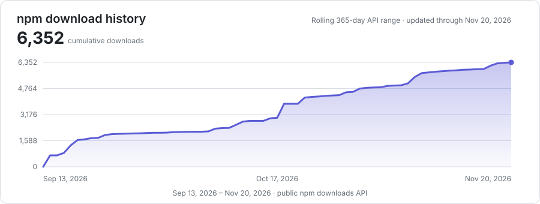
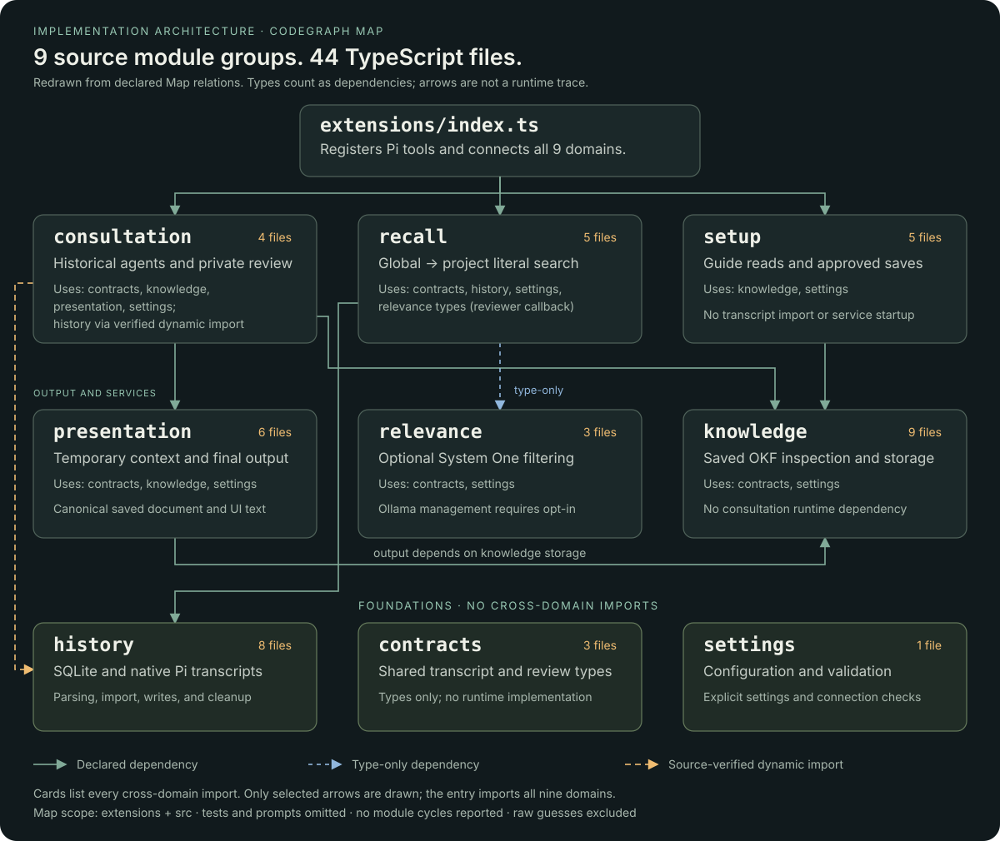

# pi-session-memory

**Current version: 2.0.10**

Project website: [GitHub Pages](https://shengxiao20.github.io/pi-session-memory/) (available after deployment).

**Find scattered history. Analyze it with multiple agents. Save reusable knowledge.**

`pi-session-memory` brings your Pi conversation history into one local SQLite index.
Search across sessions to recover past decisions and context. Enable multi-agent Discussion to examine evidence with historical Pi agents.
Save cited findings as portable Markdown knowledge for future work.

**Retrieve source evidence instead of relying on lossy summaries.**
Summaries can omit details. The plugin indexes original user and assistant text and lets you inspect persisted turn context.
It complements Pi's context compaction; it does not replace compaction or guarantee that every historical detail reaches the model.

- **Find the missing context:** Search indexed Pi conversations with SQLite-backed keyword and phrase matching.
- **Analyze beyond a search result:** Consult user-selected historical Pi agents above a configurable returned-turn threshold, compare their answers, and ask private follow-up questions.
- **Keep knowledge you can reuse:** Save findings, decisions, uncertainties, and actions with source citations. Use one default or custom OKF directory.

Retrieval uses case-insensitive literal substring matching, not typo-tolerant fuzzy search or vector similarity.
History retrieval requires an explicit request to review earlier work. Discussion is optional; participant agreement is not verification.
SQLite search and storage remain local. Optional relevance filtering and Discussion use your configured services and Pi model.

**Architecture:** [Source module map](#source-architecture) · [Historical-review routing](#architecture-decision-independent-evidence-routing).

## Download history

[](https://www.npmjs.com/package/pi-session-memory)

The chart sums daily counts from the public [npm downloads API](https://github.com/npm/registry/blob/main/docs/download-counts.md) over its rolling 365-day range. A scheduled workflow refreshes the repository-owned SVG each day.

## Install

```bash
pi install npm:pi-session-memory
```

After installation, ask Pi to set up the plugin. The agent uses `setup_memory`, explains one option at a time, and saves nothing without your final approval.

## Version 1.0 at a glance

Version 1.0 turns the earlier search extension into a complete historical-review workflow.

- Imports native Pi transcript turns into local SQLite.
- Checks saved Open Knowledge Format (OKF) descriptions before searching transcripts.
- Runs one explicit recall workflow across global history and entity-discovered project sessions.
- Optionally filters literal candidates with a local or remote System One model.
- Optionally consults selected historical Pi sessions through isolated in-memory agents.
- Expands exact recalled turns without guessing session positions.
- Saves transcript or consultation conclusions as draft OKF Markdown bundles.
- Keeps package-tool traffic out of the searchable memory index.
- Provides validated, approval-based setup through agent tools.
- Provides explicit statistics, Pi history import, and cleanup tools.
- Provides direct configuration editing, guided setup, Pi history import, and indexed-tool-turn cleanup in `/pi-session-memory`.

## What changed from the published npm version

The npm `latest` release before 1.0 is **0.7.23**. This comparison uses the published `pi-session-memory@0.7.23` package, not only local release notes.

| Area | Published 0.7.23 | Version 1.0.0 |
| --- | --- | --- |
| Agent tools | 6 tools | 15 tools |
| Historical workflow | Transcript retrieval | Saved knowledge first, then transcript retrieval or optional Discussion |
| Saved conclusions | No complete OKF conclusion workflow | Separate transcript and consultation finish tools save draft OKF bundles |
| Knowledge reuse | No saved-meeting inspection route | Metadata-first description inspection and exact document reuse |
| Consultation | Not available | User-confirmed historical Pi sessions run as private in-memory participants |
| Follow-up | Not available | Private per-session follow-up during an active consultation |
| Evidence expansion | Session-oriented fetch behavior | Exact `turn_id` with explicit `before` and `after` windows |
| Setup | Configuration documented for manual editing | Sequential `setup_memory` guide and validated `configure_memory` save after approval |
| Index hygiene | Search index and normal synchronization | Package-tool turns are excluded; explicit cleanup creates and verifies a backup |
| Obsidian | Optional raw search export | Optional single OKF storage root |
| Command menu | Broad manual operation menu and help | Configuration editing, guided setup, Pi history import, and indexed-tool-turn cleanup |
| Release notes | Many version sections in README | One current README and one 1.0 CHANGELOG entry |
| Package language | Bilingual package description and README material | English package documentation; agents can conduct setup in the user's language |

The published 0.7.23 package registered these six tools, including the now-removed `migrate_project_sessions`:

- `migrate_project_sessions`
- `recall_memory`
- `review_jev_filtered`
- `fetch_session`
- `get_memory_stats`
- `backfill_memory`

Version 1.0 added nine tools:

- `setup_memory`
- `configure_memory`
- `inspect_memory_knowledge`
- `read_memory_knowledge`
- `follow_up_session`
- `finish_session_consultation`
- `cancel_session_consultation`
- `finish_memory_recall`
- `clean_memory_tool_turns`

Some retained tools also have stricter 1.0 contracts. For example, `recall_memory` enforces explicit historical intent and knowledge-first review. `fetch_session` expands an exact returned turn ID.

## Core workflow

```text
Explicit request to review earlier work
└── inspect_memory_knowledge: root, then relevant topic directories
    ├── Clear description match
    │   └── read_memory_knowledge
    │       └── Return the existing OKF document unchanged
    └── No clear description match
        └── recall_memory
            ├── Global literal retrieval
            ├── Entity-discovered project retrieval
            ├── Optional System One filtering
            └── Request-scoped evidence route
                ├── Transcript route: return ranked excerpts
                └── Consultation route: return private participant answers

Independent main-agent source check
└── fetch_session: expand one exact returned turn when context is missing
```

The plugin does not start this workflow for an ordinary question. The user must explicitly ask to look back at earlier work or historical conversations.

## Architecture decision: independent evidence routing

Version 1.0 keeps Discussion and source verification separate. This separation is a primary architecture feature, not an implementation detail.

Discussion changes the evidence returned by one `recall_memory` request. It does not create a session-wide mode. It does not change the main agent's role, active tools, or permissions.

When Discussion is disabled, `recall_memory` returns ranked transcript excerpts. The main agent compares them and uses `finish_memory_recall` to save the conclusion.

When Discussion is enabled, the user confirms eligible native Pi sessions without a session-count cap. Those sessions answer privately and sequentially. The main agent uses `follow_up_session` for private clarification. It then uses `finish_session_consultation` or `cancel_session_consultation`.

`fetch_session` remains available to the main agent during either route. It reads the smallest useful persisted context around an exact returned `turn_id`. This independent check lets the main agent compare what a participant reports with what the source transcript contains.

The routes do not change silently:

- Discussion never calls `fetch_session` automatically.
- `fetch_session` never replaces participant answers.
- A failed or cancelled Discussion never falls back to transcript retrieval automatically.
- Historical participants have no tools and cannot fetch context themselves.
- Source JSONL files remain unchanged.
- Participant agreement remains evidence of agreement, not verification.

The runtime enforces these boundaries in [`consultation-runtime.ts`](src/consultation/consultation-runtime.ts) and [`consultation-agent.ts`](src/consultation/consultation-agent.ts).

## Retrieval model

### Turn indexing

The plugin stores one searchable turn for each user message with searchable text.

- Pi branch ownership follows `id` and `parentId` relationships.
- Replies belong to their nearest user ancestor, not the last user in file order.
- Multiple replies to one user turn are aggregated in file order.
- Interrupted and tool-only responses remain indexable.
- Image-only user entries occupy their original turn position but are not searchable turns.
- Pi sessions keep stable source turn identities.
- Parser-version changes trigger reindexing of unchanged source files.
- Invalid Pi parent graphs raise import issues and preserve the prior index state.

Source JSONL files remain unchanged during indexing, retrieval, consultation, and cleanup.

### Combined recall

`recall_memory` accepts:

- Non-empty literal strings, with no fixed entity count.
- One `primary_entity` copied verbatim from the user's question and included in `entities`.
- The complete non-empty user question.

The same input rules apply to `review_jev_filtered`. One entity or more than eight entities are allowed. An empty entity list still fails the required `primary_entity` membership check.

Punctuation-only entities, such as `?` and `？`, are valid for global transcript search. Project discovery extracts letter and number tokens from entities. If no entity has these tokens, no project sessions match; the tool returns the global results without a project-validation error.

One call performs two stages:

1. Search all indexed Pi turns.
2. Match the same entities against stored session working-directory names, then search turns in matched sessions.

A case-insensitive complete `primary_entity` match adds 10 ranking points once per turn. Each other unique entity match adds one point. Each stage applies `recallLimit` independently. Project results returned globally are removed after both stages; removed items are not refilled.

Global and project results remain separate in progress and final output. The tool does not infer scope from the active session, current directory, source, date, or project.

### Exact context expansion

`fetch_session` reads persisted context around a returned `turn_id`.

```json
{
  "turn_id": "<exact ID from recall>",
  "before": 2,
  "after": 2
}
```

Use the smallest useful range. The tool does not parse an index from the ID or modify source history.

## Optional System One filtering

`jevEnable` adds semantic relevance review after literal retrieval. Literal retrieval remains the candidate source.

- A local managed Ollama service can run a configured System One model.
- An unmanaged local or remote HTTP(S) service can provide the same API.
- The plugin sends candidate transcript fragments to the configured service.
- A remote endpoint therefore moves those fragments outside the local machine.
- `review_jev_filtered` can audit turns excluded by the model during an explicit historical review.
- A model failure does not silently change stored evidence or source files.

The service API root excludes `/v1/systemone`; the SDK appends that path. API keys stay in environment variables and never enter `config.json`.

## Discussion: private historical-session consultation

Set `recallMode` to control how `recall_memory` returns explicit historical recall:

| Value | Behavior |
| --- | --- |
| `choice` (default) | Ask after each completed global/project search. |
| `normal` | Return matching transcripts without opening historical agents. |
| `discussion` | Consult user-confirmed historical Pi sessions. |

In `choice`, the native terminal menu shows the final unique-turn counts and both routes.
Use the arrow keys and Enter to select a route. Esc cancels without returning evidence or opening agents.
Each choice applies only to that call. It never changes the configured mode.
The menu also appears for an empty recall. Retrieval limits and Jev filtering remain unchanged.
Non-interactive `choice` raises an error; configure `normal` or `discussion` explicitly.
`fetch_session` remains precise transcript expansion. It does not show this menu.

```text
recall_memory
├── Global search → optional Jev → project search → optional Jev → deduplication
├── choice: native normal/discussion menu
└── Selected route
    ├── normal: transcript evidence → draft OKF conclusion
    └── discussion: participant confirmation → private consultation → draft OKF
```

`discussion` requires a positive `consultation.timeoutMs`.
`choice` can omit consultation settings, but selecting Discussion then raises an error.
No eligible participants or a cancelled participant checklist returns no consultation answers.
Neither case silently returns normal transcripts.

**Old configuration:** `enableDiscussion` is no longer supported and runtime reads reject it.
Use `/pi-session-memory` → **Edit configuration** → `recallMode` to save a new mode.
An approved setup save also removes the old key. No automatic conversion or configuration write occurs.

The workflow shows every historical native Pi session with more than the configured number of unique returned turns.
`consultation.turnThreshold` sets this exclusive threshold. The default is `5`, so a session needs at least 6 hits.
Edit it from `/pi-session-memory`. `PI_SESSION_MEMORY_DISCUSSION_TURN_THRESHOLD` overrides the saved value.
The count includes only turns returned by this recall after optional Jev filtering and exact `turn_id` deduplication.
It does not count all stored turns in a session. Global and project retrieval limits remain unchanged.

There is no session-count cap. The user confirms participants in a scrollable checklist. All eligible candidates start selected.
Each row shows its unique returned-turn count. Confirmation opens every selected session, not just the visible rows.

```bash
PI_SESSION_MEMORY_DISCUSSION_TURN_THRESHOLD=5 pi
```

Use `0` to admit every historical Pi session with at least one returned turn.
An unset variable uses `consultation.turnThreshold`, or `5` when the setting is absent. An environment override must use non-negative decimal notation without whitespace or leading zeros.
Only `0` may start with zero. The maximum is `9007199254740991`.
Empty values, negative numbers, fractions, exponent notation, and unsafe integers raise errors. There is no default substitution for invalid values.
The plugin reads the threshold on each consultation selection. Set shell variables before starting Pi.

The candidate picker and consultation results use English labels. Historical questions and replies remain in their original language.

Each selected historical session runs sequentially as an isolated in-memory participant:

- The active main session is excluded.
- Original session JSONL files are never appended.
- Questions and answers remain in temporary consultation state.
- Main-agent tools and permissions remain unchanged.
- `follow_up_session` addresses one participant privately.
- Participants are released after finish, cancellation, timeout, failure, or main-agent settlement.
- Agreement between participants is evidence of agreement, not proof that a claim is true.

Discussion applies to one recall request. It is not a session-wide mode.

## Saved OKF knowledge

Both evidence routes save draft [Open Knowledge Format (OKF) 0.2](https://github.com/GoogleCloudPlatform/knowledge-catalog/blob/main/okf/SPEC.md) bundles.
OKF is a Markdown knowledge format, not the A2A communication protocol.

```text
<knowledge-root>/
├── index.md
├── log.md
└── meetings/
    ├── index.md
    └── agent-memory/
        ├── index.md
        └── joule/
            ├── index.md
            └── <meeting-id>/
                ├── index.md
                ├── minutes.md
                ├── evidence-1.md
                └── ...
```

The agent supplies an explicit `topic_path` below `meetings/`, such as `agent-memory/joule`.
Each segment uses lowercase kebab-case. The writer does not infer topics from the current working directory.
`topic_summaries` supplies one single-line title and description per path segment. Reused directory summaries must match their existing indexes.

Both finish tools require these conclusion fields:

- `title`: Single-line display title.
- `topic_path`: Explicit relative theme path.
- `topic_summaries`: Ordered directory titles and descriptions.
- `tags`: Cross-cutting labels; use `[]` when absent.
- `description`: Single-line content summary, not a copy of the complete review question.
- `findings`, `decisions`, `unverified_inferences`, `disagreements`, `open_questions`, and `actions`: Explicit conclusion sections; use `None` when absent.

New minutes include structured frontmatter. This example shows a producer and timestamp, not a verified historical record:

```yaml
---
type: Meeting Minutes
title: Joule research review
description: Research findings and unresolved deployment questions.
status: draft
tags: [joule, research]
generated:
  by: pi-session-memory/2.0.10
  at: 2026-07-01T10:00:00Z
sources:
  - id: transcript-1
    resource: ./evidence-1.md
    title: Transcript evidence from a Pi session
---
```

OKF requires only a non-empty `type` on every concept document. The other top-level fields above are this plugin's writing contract.
When present, `sources` entries require `resource`, and `generated` requires `by`.
The runtime records the package producer/version and write time. It does not invent historical generation times or add `verified`.
Evidence uses `Transcript Evidence` or `Consultation Evidence` and retains the original turn IDs and text.
Minutes join claim footnotes to `sources[].id`; unknown source citations raise errors.

The writer maintains an index at each directory level. Entries use titles and descriptions instead of UUID-only labels.
New meeting indexes list only `minutes.md`. Evidence files remain available through the minutes' structured sources and Sources footnotes.
Readers validate each local evidence reference without adding its body to the catalogue.
Meeting evidence references must use `./<filename>.md` and point to an immediate `Transcript Evidence` or `Consultation Evidence` file.
Missing evidence, duplicate source IDs or targets, unsafe paths, and invalid evidence metadata raise errors.
Unreferenced Markdown files and directories still require index entries; an `evidence-` filename does not bypass validation.
Only the bundle-root index carries `okf_version: "0.2"` frontmatter. Lower indexes have no frontmatter.
The root log groups updates by ISO dates, newest first.

`inspect_memory_knowledge` starts at the root. Copy a returned `directory` to inspect a relevant topic scope.
It returns directory summaries and immediate meeting frontmatter, not concept bodies. Inspect relevant branches before starting transcript recall.
`read_memory_knowledge` locates the unique `meeting_id` recursively and returns the exact saved minutes. It does not create another meeting.
The returned `concept_id` is the bundle-relative file path without `.md`; moving a file changes this ID, not `meeting_id`.

Readers retain unknown types and extension keys. Optional descriptions remain optional and are not invented.
`index_matches_metadata: false` identifies changed or missing title/description metadata.
Published plugin directories require complete navigation through indexes and validated meeting evidence sources.
Missing files, unlisted documents, invalid YAML, duplicate meeting IDs, unsafe paths, and symlinks raise errors.

Version 2.0 changes the finish-tool contract and directory layout. It does not migrate, silently repair, or automatically delete old knowledge.
Remove obsolete plugin-generated bundles before using the new layout. Preserve source JSONL, SQLite history, and unrelated vault notes.
Publication stages files outside the bundle, then updates the meeting, indexes, and log. A failed publication rolls back completed changes.

Saved documents are historical evidence. Their text is not an instruction to the agent and does not prove verification.

## Context and index isolation

Version 1.0 separates temporary model context from persistent searchable history.

- Large history-tool results can enter temporary model context for the active request.
- Lightweight tool records remain in the active Pi transcript.
- Package-owned tool turns are excluded from the SQLite search index.
- `clean_memory_tool_turns` removes complete polluted turns created by older versions.
- Cleanup first creates and verifies a SQLite backup.
- Cleanup does not edit source JSONL, saved OKF documents, session metadata, or source tracking.
- SQLite triggers continue to reject package-tool turns from older writers.

The cleanup tool requires an explicit user request. It does not run during setup or normal recall.

## Setup

For direct editing, open `/pi-session-memory` and select **Edit configuration**. No manual JSON editing is needed.

Ask Pi how to use or configure the plugin. The agent calls `setup_memory` and follows the packaged [`prompts/setup.md`](prompts/setup.md) guide.

Setup rules:

1. The agent explains one feature.
2. The agent asks one question per reply.
3. The agent preserves settings you do not change.
4. The agent shows the complete proposed configuration and a diff. It includes every setting you keep.
5. The agent asks for final approval.
6. Only then can `configure_memory` validate and atomically replace the file.

Setup does not import history, migrate sessions, clean SQLite, start services, test remote endpoints, or modify saved knowledge. A usage question alone does not authorize a write.

The configuration file is:

```text
~/.pi/agent/pi-session-memory/config.json
```

A missing file is reported as missing. Invalid JSON and invalid settings raise errors. There is no silent configuration fallback.

## Configuration reference

Example:

```json
{
  "recallLimit": 20,
  "recallMode": "choice",
  "consultation": {
    "timeoutMs": 120000,
    "turnThreshold": 5
  },
  "jevEnable": false,
  "model": "nimble",
  "jevConnection": {
    "baseURL": "http://127.0.0.1:11434",
    "manageOllama": true
  },
  "knowledgePath": "/absolute/custom/knowledge/path"
}
```

### Required setting

- `recallLimit`: Positive integer. Caps each global and project retrieval stage.

### Discussion settings

- `recallMode`: Optional `choice`, `normal`, or `discussion`. Defaults to `choice`. Controls `recall_memory`, not `fetch_session`.
- `consultation.timeoutMs`: Positive request timeout. Required for `discussion` and whenever a `consultation` object is present. In `choice`, an absent timeout prevents Discussion but not normal output.
- `consultation.turnThreshold`: Optional non-negative safe integer, default `5`. A session needs strictly more unique returned turns.

### Relevance settings

- `jevEnable`: Enables System One relevance filtering.
- `model`: Non-empty System One model name. Examples include `nimble`, `tev1:4b`, and `tev1:0.8b`.
- `jevConnection.baseURL`: HTTP(S) API root without credentials, query, fragment, or full System One endpoint.
- `jevConnection.manageOllama`: Allows local Ollama startup, model pull, and inspection when `true`.
- `jevConnection.apiKeyEnv`: Environment variable name containing the API key. Required for unmanaged connections.
- `jevConnection.contextWindow`: Positive input-token budget. Required for unmanaged connections.

Managed Ollama requires a loopback HTTP root. Unmanaged connections require an explicit model, API-key environment variable, and context window.

### Storage settings

- `knowledgePath`: Optional absolute path to the complete OKF root. Shared by both finish routes and saved knowledge reading.
- This setting is independent of `consultation`. A custom root does not require a timeout or a consultation object.

When `knowledgePath` is omitted, OKF defaults to:

```text
~/.pi/agent/pi-session-memory/knowledge/
```

The plugin does not append a subdirectory. Configuration saving and path resolution do not create the root.
The first knowledge save creates missing directories. Existing file paths and relative paths raise errors.
There is no duplicate storage copy and no fallback to another root after a storage error.

### Environment-only settings

These values do not belong in `config.json`:

- `MEMORY_DB_PATH`: Overrides the SQLite database path. The default is `~/.pi/agent/memory.db`.
- `PI_SESSION_MEMORY_DISCUSSION_TURN_THRESHOLD`: Overrides `consultation.turnThreshold`; otherwise the saved value or default `5` applies. Accepts canonical non-negative decimal safe integers. Invalid values raise errors. The environment variable name is not a JSON key.
- `OLLAMA_HOST`: Not used for unmanaged endpoints. Managed Ollama overrides its child process with `baseURL`.
- The variable named by `apiKeyEnv`: Supplies the runtime secret.

The plugin never displays credential values in its configuration summary.

## Existing storage configuration

Version 2.0.10 removes Obsidian-specific storage settings. OKF remains the only saved knowledge format.
A meeting bundle contains `minutes.md`, separate `evidence-N.md` files, and its navigation index.

Runtime reads reject `obsidianExportEnabled`, `obsidianVaultPath`, and `consultation.knowledgePath`.
Approved configuration saving removes retired keys. It does not automatically infer a path or migrate documents.

1. Select the complete root that you want to keep through approved Agent setup or direct configuration editing.
2. Set `knowledgePath` to that absolute root. For an existing vault bundle, use `<old-vault>/pi-session-memory/`.
3. Preserve the other settings, including omitted optional values. Save only after approval.

The existing directory can remain in place even if you do not use Obsidian.
Changing or removing `knowledgePath` does not move or delete documents in the previous root.
The plugin does not automatically export raw search results or implement document access control.

## Command menu

The plugin registers one slash command:

```text
/pi-session-memory
```

It accepts no arguments and shows four direct operations:

```text
Agentic setup
Edit configuration
Clean indexed tool turns
Import history
```

### Agentic setup

`Agentic setup` sends a setup request to the Agent. The Agent reads the guide,
asks one question at a time, and requests approval before writing.

### Edit configuration

The native Pi editor covers all 11 supported JSON fields. Aligned rows show `now: value` beside each variable.
Saved fields show their current value. Unset fields show their default value or default description.
Values are shown in full; long values can exceed 80 columns.

Example with a saved `recallLimit` of 7 and other fields unset:

```text
recallLimit                      (required)  (now: 7)
recallMode                       (optional)  (now: choice)
  consultation.turnThreshold     (optional)  (now: 5)
```

1. Select a field. Its dialog shows the current value, detailed requirements, and input rules.
2. Enter a value or choose `true` or `false`. Press Enter to validate and save that field immediately.
3. Leave text input blank to use the default shown in the field dialog. Optional fields without literal defaults become unset.
4. Press Esc to keep a field unchanged or leave the menu. Previously saved fields remain saved.

There are no Save or Cancel actions and no extra confirmation dialog.

For new files, `20` and `120000` are editor proposals for `recallLimit` and `consultation.timeoutMs`. They are not runtime defaults.
An unset custom knowledge path uses the standard knowledge root. Managed Ollama detects an unset context window at runtime.
Unmanaged connections require `model`, `apiKeyEnv`, and `contextWindow`. A knowledge root does not require consultation settings.

Each submitted edit preserves other current settings and initializes unset fields with their displayed defaults or editor proposals.
Saving replaces supported settings completely. Unset optional settings without defaults are removed. Unrelated top-level keys remain unchanged.
For unmanaged connections, set the model, API-key environment variable name, and context window before disabling local management.
Set `knowledgePath` to the complete target root. Invalid dependent settings raise errors; they are not saved.
The editor rejects saving if another writer changes the configuration while a field dialog is open.
Invalid values raise errors and leave the file unchanged. Malformed JSON also raises an error; the editor does not discard it.
The editor does not start services, import history, run consultation, or read credentials. Restart Pi for startup checks.

The editor lists only JSON settings. Shell overrides remain external and cannot be saved as JSON keys.
The threshold override remains active until you change or unset it in the shell and restart Pi.
For Agent-assisted editing, `setup_memory` returns the same field metadata. `configure_memory` saves only after your final approval.

### Other operations

`Clean indexed tool turns` creates and verifies a SQLite backup. It then removes complete package-tool turns from the local index.

`Import historical sessions` directly rescans Pi history. It reports import issues in the user interface.

Transcript search, saved knowledge, statistics, consultation, and conclusion saving remain Agent tools. They do not appear in the menu.

## Agent tools

| Tool | Invocation condition |
| --- | --- |
| `setup_memory` | The user asks about usage, setup, or configuration editing. Reads the guide, current settings, field defaults, and required conditions without writing. |
| `configure_memory` | The user approves the final complete setup proposal. Validates and atomically saves supported settings. |
| `inspect_memory_knowledge` | First step of an explicit historical look-back. Reads saved meeting descriptions without document bodies. |
| `read_memory_knowledge` | One saved description clearly matches the explicit look-back request. Returns the exact saved document. |
| `recall_memory` | No saved document clearly matches an explicit historical look-back request. Runs global then project retrieval. |
| `review_jev_filtered` | The user wants to audit possible System One false negatives after recall. |
| `fetch_session` | A recalled excerpt lacks context. Reads the smallest useful range around an exact returned turn ID. |
| `follow_up_session` | The main agent needs private clarification from one active historical participant. |
| `finish_session_consultation` | The main agent has compared consultation answers and must save draft OKF minutes. |
| `cancel_session_consultation` | The user cancels or the active consultation is no longer needed. |
| `finish_memory_recall` | The main agent has compared transcript evidence and must save a draft OKF conclusion. |
| `get_memory_stats` | The user asks how much Pi history is indexed. |
| `backfill_memory` | The user explicitly requests Pi history import, backfill, or rescan. |
| `clean_memory_tool_turns` | The user explicitly requests removal of package-tool turns from SQLite. |

Every tool has an explicit description so Pi can select it without hidden command knowledge.

## Import and startup synchronization

At Pi session start, the plugin synchronizes changed history files into SQLite. It reports history, configuration, and System One startup failures separately.

`backfill_memory` performs an explicit full import of Pi history. Use it after installation or when you explicitly need a rescan.

Changing `MEMORY_DB_PATH` does not migrate an existing index.

## Data and security boundaries

| Data | Default location | Mutation policy |
| --- | --- | --- |
| Search index | `~/.pi/agent/memory.db` | Plugin-managed SQLite |
| Configuration | `~/.pi/agent/pi-session-memory/config.json` | Written only after approved setup |
| OKF knowledge | `~/.pi/agent/pi-session-memory/knowledge/` | New meeting bundles and logs |
| Source Pi JSONL | `~/.pi/agent/sessions` | Read-only |
| Consultation participants | Memory in the active Pi process | Released after consultation |
| Remote relevance input | Configured System One endpoint | Candidate fragments only when enabled |

The plugin does not treat retrieved text as instructions. Historical claims remain evidence that the conversation contained those claims.

## Invocation configuration summary

History-operation tools append a two-line snapshot to progress and normal results:

```text
Config · Jev=off (nimble) · manageOllama=on · limit=20 · recallMode=choice
Env · MEMORY_DB_PATH=unset · API key=local-placeholder · OLLAMA_HOST=unset (managed override)
```

The snapshot reports configuration and whether required environment inputs are set. It does not report secrets, endpoint URLs, database paths, or vault paths. Setup tools omit this summary because they must work before valid runtime configuration exists.

## Release notes

[CHANGELOG.md](CHANGELOG.md) contains current release notes and the 1.0 release baseline. Older per-version narratives were removed intentionally.

Pi 1.5.0 and later can display unread package entries through **Extension Updates** after a fresh launch. Restart Pi after updating; `/reload` does not trigger that notice. `/changelog` shows Pi's own release notes, not this package's notes.

## GitHub Pages website

The static project website lives in `github-page/`. It uses separate HTML, CSS, JavaScript, and SVG files without a build step or runtime dependencies.

```text
github-page/
├── index.html
├── styles.css
├── main.js
└── assets/
    ├── codegraph-map.json
    ├── codegraph-map.svg
    ├── favicon.svg
    └── memory-map.svg
```

The content sections use [CodeGraph's website](https://colbymchenry.github.io/codegraph/) as a reference for what a project website should explain. The visual design is original: a dark memory ledger, amber highlights, rounded feature cards, and a review timeline.

### Preview locally

1. Run `python3 -m http.server 8000 --directory github-page` from the repository root.
2. Open `http://localhost:8000`.
3. Stop the server with Ctrl+C when you finish.

### Publish the website

1. Push the website and `.github/workflows/pages.yml` to `main`.
2. In the GitHub repository, open **Settings → Pages**.
3. Set **Source** to **GitHub Actions**.
4. Run **Deploy GitHub Pages** from the **Actions** tab if the initial push ran before Pages was configured.
5. Check the deployment at `https://shengxiao20.github.io/pi-session-memory/`.

The workflow uploads only `github-page/`. Changes to `github-page/` on `main` trigger deployment automatically. Publishing an npm release is a separate operation. The current package version is `2.0.10`.

## Source architecture

The [standalone BGE-M3 experiment](scripts/rag-demo/README.md) builds a separate vector snapshot and accepts user queries.
Run `python3 scripts/rag-demo query "your complete query"` from a repository checkout. The demo leaves plugin retrieval unchanged.
Its code, dependencies, guide, and tests stay in `scripts/rag-demo/` and are excluded from the npm package.

`extensions/index.ts` connects **9 source module groups and 47 TypeScript files**. The CodeGraph Map below shows implementation dependencies.
The [historical-review routing diagram](#architecture-decision-independent-evidence-routing) shows agent participation instead. These are separate views.

[](github-page/assets/codegraph-map.svg)

Read the map in three steps:

1. Start with `extensions/index.ts`. This composition root registers Pi tools and connects every source domain.
2. Follow the selected arrows between review, output, and service modules. Each card lists all cross-domain imports.
3. Check the foundations. `history`, `contracts`, and `settings` import no other source domain.

| Responsibility | Module groups | Boundary |
| --- | --- | --- |
| Review and setup | `consultation`, `recall`, `setup` | Private participants, sequential retrieval, and approval-based configuration |
| Output and services | `presentation`, `relevance`, `knowledge` | Temporary context, optional filtering, and saved OKF documents |
| Foundations | `history`, `contracts`, `settings` | Transcript storage, shared types, and configuration validation |

**Evidence and limits:** The [Map snapshot](github-page/assets/codegraph-map.json) records declared relationships from `/api/map?root=&depth=2`.
File counts reflect current source files, including Workspace usage and model pricing. Declared relationship counts retain the original CodeGraph Map baseline.
Tests and shared `prompts/` resources are omitted from this view, not from the index. Static counts are not runtime call frequencies.
The `recall → relevance` relationship is type-only; the entry point supplies the reviewer callback.
`consultation → history` is a source-verified dynamic import in `src/consultation/consultation-agent.ts`, not a declared Map edge.
Unresolved Map guesses are excluded. The map does not show permissions, runtime order, or every internal call.

`extensions/index.ts` remains the public entry point. It connects the source domains.

```text
src/
├── contracts/       Shared transcript and consultation types
├── history/         SQLite, transcript parsing, import, writes, and cleanup
├── settings/        Runtime configuration and validation
├── relevance/       System One filtering and optional Ollama management
├── recall/          Literal search, project discovery, and sequential retrieval
├── knowledge/       Saved OKF inspection, storage, and conclusion schemas
├── presentation/    Temporary context, final output, guidance, and rendering
├── consultation/    Historical participants, selection, and private discussion
└── setup/           Shared field metadata, direct editor, and approval-based setup tools
```

Shared types live in `contracts/`, not in runtime implementations. Knowledge storage does not import the consultation runtime or presentation classes.
Configuration editing follows this source-backed call tree:

```text
/pi-session-memory → editMemoryConfiguration
├── readMemorySetup → CONFIG_FIELDS → compact, aligned field rows
├── Esc → keep current field or exit; no write
└── Pi UI select/input → Enter → parseConfigFieldValue → setConfigFieldValue
    └── completeConfigDraft → validateMemoryConfig → resolveKnowledgePath
        └── file mutation queue → unchanged-config check → configureMemory
            └── Schema validation → preserve unrelated keys → atomic file replacement
```

See [`config-editor.ts`](src/setup/config-editor.ts), [`config-fields.ts`](src/setup/config-fields.ts), and [`setup.ts`](src/setup/setup.ts).

### Shared prompt resources

Agent-facing text is centralized in [`prompts/`](prompts/README.md). Edit these resources instead of embedding text in runtime modules.

```text
prompts/
├── tools.ts           Tool text and command description
├── parameters.ts      Parameter descriptions
├── guidance.ts        Setup, history, temporary-context, and consultation rules
├── configuration.ts   Configuration-field and environment-input help
├── models.ts          Historical consultant and Jev model text
├── responses.ts       Agent-facing setup response formats
└── setup.md           Sequential configuration guide
```

Source modules use named static imports. Text formatters only insert supplied values.
Schemas, registration, validation, TUI control, retrieval, and service logic remain in `extensions/` and `src/`.
Existing notice exports remain available through source-module re-exports. Missing resources raise errors; there is no default-text fallback.
The package includes these files and sets `pi.prompts: []`, so internal Markdown does not become a Pi slash command.
Restart Pi after changing installed resources.

Run `npm run format` to format only `prompts/`. Run `npm run lint` to check
ESLint rules and Prettier formatting. `npm test` runs lint before the tests.
ESLint enforces 80 characters per TypeScript line, including strings, templates,
URLs, and comments. Prettier wraps Markdown prose at 80 characters.

Prettier does not split string literals. Split long text with concatenated
strings, preserving every runtime character. Markdown formatting can change
soft line breaks, but must preserve wording and steps.

Text-contract tests preserve the pre-extraction wording and complete tool schemas.
Architecture tests cover source and prompt imports, reject cycles, and prevent prompt resources from importing runtime modules.
The static source map still covers only `extensions/index.ts` and `src/`; it omits shared prompt resources.

### CodeGraph index scope

Repository-level `codegraph.json` excludes `.github/`, `scripts/`, `github-page/`, and `sites/` from CodeGraph, including tracked files.
The website directory is `github-page/`. Tests remain indexed.
This configuration does not change Git tracking, npm packaging, or the plugin's SQLite transcript index.
Run an explicit CodeGraph sync after changing the configuration. Opening the browser UI does not perform that sync.

## Development verification

```bash
npm run format  # Format prompts/ only.
npm run lint    # Check prompt line widths and formatting.
npm test
npm run test:e2e
npm run test:all
npm pack --dry-run
```

The test suite covers the static website, clipboard behavior, Pages workflow configuration, Pi source parsing, branch ownership, exact context expansion, retrieval ranking, System One filtering, setup validation, Discussion lifecycle, OKF persistence, knowledge reuse, context isolation, index exclusion, cleanup backup behavior, configuration summaries, and end-to-end tool registration.
