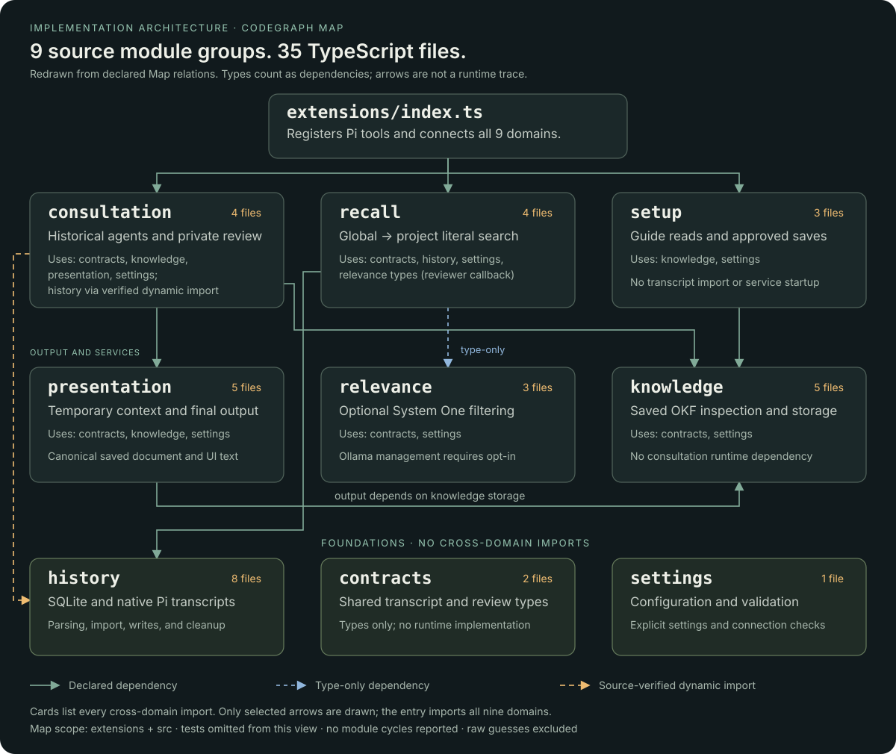

# Source architecture

`extensions/index.ts` is the composition root. It registers Pi tools, commands, and lifecycle handlers, then connects the domain modules.
The directory refactor does not change public tool names, configuration keys, storage formats, or historical-review routing.

## CodeGraph Map view

[](../site/assets/codegraph-map.svg)

The [sanitized Map snapshot](../site/assets/codegraph-map.json) records `/api/map?root=&depth=2` output for the entry point and source domains.
The illustration is a documentation redraw, not a browser screenshot or a runtime trace. It groups 35 source files into nine domains.
Cards list all cross-domain dependencies. Selected arrows show the main implementation relationships; imports from the entry point and shared-type references are not all drawn.

The snapshot retains only links with `declared > 0`. CodeGraph counts resolved static relationships, including type-only imports.
These counts are not call frequencies. Tests stay indexed but do not appear in this view.
The map reports no module cycles for this snapshot. The architecture test independently checks source imports and file-level cycles.

Two raw Map links have `declared = 0`: `consultation → history` and `history → consultation`.
`src/consultation/consultation-agent.ts` verifies the first with `await import("../history/db.ts")`.
The snapshot records it separately as a reviewed dynamic import. The reverse guess has no source import and is not shown.
The `recall → relevance` import supplies types only; the entry point provides the relevance reviewer callback.

### Refresh the documentation map

1. Explicitly sync the selected repository with CodeGraph. Opening the browser UI does not sync it.
2. Read `/api/map?root=&depth=2` from the local, read-only UI for that repository.
3. Keep `extensions/index.ts` and `src/` modules. Keep declared links and review dynamic imports against source.
4. Update `site/assets/codegraph-map.json` and the shared `site/assets/codegraph-map.svg` together.
5. Run `npm run test:all`. The architecture test compares snapshot dependencies and file counts with current source imports.

README and GitHub Pages use the same SVG. The npm package includes both documentation assets.
The index retains older extraction-version metadata until an explicitly authorized rebuild. This snapshot does not certify extraction completeness.

## Module ownership

```text
src/
├── contracts/
│   ├── recall.ts                     Transcript query and result types
│   └── consultation.ts               Participant answers and evidence records
├── history/
│   ├── db.ts                         SQLite schema and row operations
│   ├── pi-turns.ts                   Native Pi transcript parsing
│   ├── writer.ts                     Current-session writes
│   ├── backfill.ts                   Explicit import and startup synchronization
│   ├── fetch-turn-context.ts         Exact turn-context expansion
│   ├── memory-index-policy.ts        Package-tool turn exclusion
│   ├── memory-index-cleanup.ts       Verified backup and index cleanup
│   └── memory-index-cleanup-tools.ts Cleanup tool and manual notification
├── settings/
│   └── config.ts                     Runtime configuration and validation
├── relevance/
│   ├── jev-filter.ts                 System One relevance review
│   ├── jev-runtime.ts                Session-scoped service connection
│   └── ollama-service.ts             Explicitly enabled local process management
├── recall/
│   ├── recall-query.ts               User-query validation
│   ├── retriever.ts                  Literal SQLite retrieval and formatting
│   ├── project-retriever.ts          Entity-based project-session discovery
│   └── recall-workflow.ts            Global then project retrieval and deduplication
├── knowledge/
│   ├── knowledge-storage.ts          Knowledge-root resolution
│   ├── memory-knowledge.ts           Saved-description inspection and document reads
│   ├── memory-knowledge-tools.ts     Knowledge tools with a narrow output interface
│   ├── meeting-conclusion-schema.ts Conclusion tool schema
│   └── meeting-minutes.ts            Atomic OKF bundle creation
├── presentation/
│   ├── memory-context.ts             Request-local evidence and persistence isolation
│   ├── memory-output.ts              Canonical final document and transcript conclusions
│   ├── tool-config-summary.ts        Configuration display and tool wrapper
│   ├── consultation-guidance.ts      Main-agent routing guidance
│   └── consultation-presentation.ts  Participant numbering and terminal rendering
├── consultation/
│   ├── consultation-agent.ts         In-memory historical Pi agents
│   ├── consultation-selection.ts     User-confirmed participant selection
│   ├── consultation-runtime.ts       Private participant lifecycle and consultation state
│   └── consultation-tools.ts         Follow-up, finish, and cancellation tools
└── setup/
    ├── setup-schema.ts               Approved configuration schema
    ├── setup.ts                      Guide reads and atomic configuration saves
    └── setup-tools.ts                Setup and configuration tools
```

## Dependency boundaries

The following list shows allowed cross-domain imports. It includes type-only imports.
Same-domain imports are allowed but must not create file-level cycles.

```text
extensions/index.ts
├── history       → no other src domain
├── settings      → no other src domain
├── contracts     → no other src domain
├── relevance     → contracts, settings
├── recall        → contracts, history, relevance, settings
├── knowledge     → contracts, settings
├── presentation  → contracts, knowledge, settings
├── consultation  → contracts, history, knowledge, presentation, settings
└── setup         → knowledge, settings
```

`contracts/` contains types only. Importing a shared shape does not load SQLite, the retrieval implementation, or a historical agent.
`memory-knowledge-tools.ts` accepts an object with `reuse(markdown)` instead of importing the presentation class.
`meeting-minutes.ts` accepts a shared `ConsultationRecord` instead of importing the consultation runtime.
`recall-workflow.ts` receives a reviewer callback. Its relevance dependency is type-only; it does not start a service itself.

`tests/architecture.test.ts` checks these boundaries, all relative TypeScript import targets, and file-level cycles.
It also checks the entry point, source layout, and CodeGraph exclusions.

## Invocation relationships

These are static invocation relationships, not runtime traces or permission changes.

```text
Pi lifecycle handlers in extensions/index.ts
├── session_start → history/backfill.syncChangedHistory
│                   → settings/config → relevance/jev-runtime
├── agent_settled  → history/writer.writeTurn
├── context       → presentation/memory-context.inject
└── message_end   → presentation/memory-output.finalize
                    → presentation/memory-context.finalize

Explicit historical-review tools
├── inspect_memory_knowledge → knowledge/memory-knowledge.inspectMemoryKnowledge
├── read_memory_knowledge    → knowledge/memory-knowledge.readMemoryKnowledge
│                              → presentation/memory-output.reuse
├── recall_memory            → recall/recall-workflow.recallSequentially
│   ├── global retrieval     → recall/retriever.recallTurns → history/db
│   ├── reviewer callback    → relevance/jev-filter.filterRecallWithJev
│   ├── project retrieval    → recall/project-retriever → history/db
│   └── selected Discussion  → consultation/consultation-runtime
│                              → consultation-selection → consultation-agent
├── fetch_session            → history/fetch-turn-context → history/db
├── finish_memory_recall     → presentation/memory-output.save → knowledge/meeting-minutes
└── finish_session_consultation → consultation/consultation-runtime.finish
                                 → knowledge/meeting-minutes

Approved setup
├── setup_memory     → setup/setup.readMemorySetup → repository setup.md
└── configure_memory → setup/setup.configureMemory → settings/config validation
```

Discussion remains request-scoped. Independent source verification remains available during Discussion.
See [ADR 0001](adr/0001-independent-source-verification.md) for the review-routing contract.

## Index scope

`codegraph.json` excludes `.github/`, `scripts/`, `site/`, and `sites/`, including Git-tracked files.
The actual website directory is `site/`. The plural exclusion preserves the requested scope if that directory is added later.
Tests remain indexed so callers in test files remain visible.

An explicit CodeGraph sync removes excluded files from an existing index and records moved source paths.
The browser UI observes changes but does not perform indexing.
These exclusions do not affect Git tracking, npm contents, or the plugin's SQLite transcript index.
